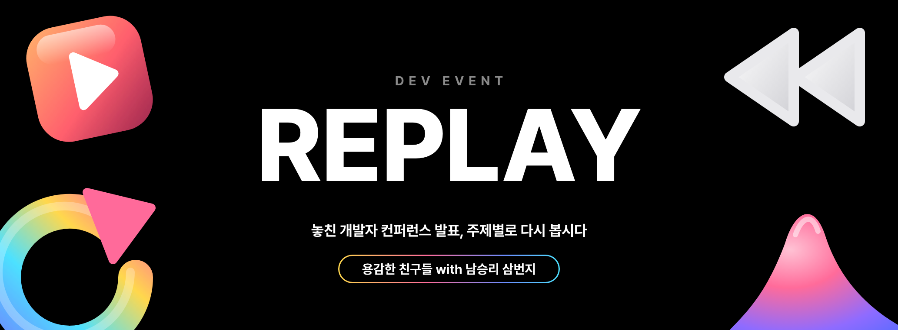

   🗓️ 다가오는 행사는 <a href="https://github.com/brave-people/Dev-Event">Dev-Event</a>에서

<!-- replay:start -->

행사 143개 · 세션 2,162개

**주제별로 보기**

> [AI (489)](./topics/ai.md) · [백엔드 (252)](./topics/backend.md) · [프론트엔드 (144)](./topics/frontend.md) · [모바일 (121)](./topics/mobile.md) · [인프라·DevOps (335)](./topics/infra-devops.md) · [데이터 (171)](./topics/data.md) · [보안 (134)](./topics/security.md) · [게임 (128)](./topics/game.md) · [디자인·기획 (71)](./topics/design-product.md) · [문화·커리어 (167)](./topics/culture-career.md) · [기타 (150)](./topics/etc.md)

**행사별로 보기**

> [2026년](#2026년) · [2025년](#2025년) · [2024년](#2024년) · [2023년](#2023년) · [2022년](#2022년) · [2021년](#2021년) · [2020년](#2020년)

## 2026년

| 행사 | 다시보기 | 세션 | 분류 | 주최 | 일시 |
|---|---|---|---|---|---|
| GUARDIANS 26 | [유튜브](https://www.youtube.com/playlist?list=PLSlwhZ7xh_jo) | [7개 보기](./events/2026-guardians.md) | `보안` | 토스 | 11. 06 |
| [if(kakao)26](https://if.kakao.com/2026) | [Keynote](https://www.youtube.com/playlist?list=PLb_R72QrkLhc) · [Day 1](https://www.youtube.com/playlist?list=PLV_adSVojhSg) · [Day 2](https://www.youtube.com/playlist?list=PLbOki5R2QjIU) | [56개 보기](./events/2026-ifkakao.md) | `기술일반` | 카카오 | 10. 13 ~ 14 |
| 토스증권 Tech Talk Talk 2026 | [유튜브](https://www.youtube.com/playlist?list=PL-245_cWUfl8fOj-0eIX2T_qFWxY3zEwm) | [8개 보기](./events/2026-toss-techtalktalk.md) | `기술일반` | 토스증권 | - |
| [KCD x Ceph x OpenInfra Day Korea 2026](https://community2.cncf.io/events/details/cncf-kcd-south-korea-presents-kcd-x-ceph-x-openinfra-day-korea-2026/) | [유튜브](https://www.youtube.com/playlist?list=PLWMwPDj3o8hM) | [27개 보기](./events/2026-kcodk.md) | `클라우드` | Kubernetes Korea Group | 09. 01 |
| [PyCon Korea 2026](https://2026.pycon.kr) | [유튜브](https://www.youtube.com/playlist?list=PLN5G1osPuVgk) | [26개 보기](./events/2026-pycon.md) | `파이썬` | 파이콘 한국 | 08. 15 ~ 17 |
| Unite Seoul 2026 | [유튜브](https://www.youtube.com/playlist?list=PL412Ym60h6usG4h2cRmeYnrtyUTzqoT6h) | [42개 보기](./events/2026-unite-seoul.md) | `게임` | 유니티 코리아 | 07. 21 |
| 데이터야놀자 2026 | [유튜브](https://www.youtube.com/playlist?list=PL7yPwpDiPFlIopEaDdupVosRq3-TmHXyt) | [12개 보기](./events/2026-datayanolja.md) | `데이터` | 데이터야놀자 | 06. 06 |
| [파이콘 부산 2026](https://event-us.kr/pythonkorea/event/122855) | [유튜브](https://www.youtube.com/playlist?list=PLZPhyNeJvHRnNMvwiarzVD3BWb_6FY4A8) | [11개 보기](./events/2026-pycon-busan.md) | `파이썬` | 파이콘 한국 | 05. 09 |
| .NET Universe 2026 | [유튜브](https://www.youtube.com/playlist?list=PLFVJi7gR5oaPmWEwo2-5spyum98OTFUjG) | [11개 보기](./events/2026-dotnet-universe.md) | `.NET` | 닷넷데브 | 03. 12 |

## 2025년

| 행사 | 다시보기 | 세션 | 분류 | 주최 | 일시 |
|---|---|---|---|---|---|
| [모두콘 2025](https://modulabs.co.kr/community/momos/424) | [유튜브](https://www.youtube.com/playlist?list=PLv6H9ngYdJbKS9QAzOD9GmGFVY8ViphRG) | [26개 보기](./events/2025-moducon.md) | `AI` | 모두의연구소 | 12. 13 |
| [제1회 PyAI 심포지움](https://event-us.kr/pythonkorea/event/115716) | [유튜브](https://www.youtube.com/playlist?list=PLZPhyNeJvHRn06pGP-TB5pGFYPwgBUpRv) | [6개 보기](./events/2025-pyai.md) | `AI` | 파이썬 한국 사용자 모임 | 11. 30 |
| GUARDIANS 25 | [유튜브](https://www.youtube.com/playlist?list=PL-245_cWUfl-kQNdnn0bqox1f5iNSc65V) | [22개 보기](./events/2025-guardians.md) | `보안` | 토스 | 11. 20 |
| [Samsung Tech Conference 2025](https://developer.samsung.com/sdp/events/ko/2025/11/13/samsung-tech-conference-2025) | [유튜브](https://www.youtube.com/playlist?list=PL7PfK8Mp1rLFfWkWgGcQIUkuz0zJKDrjc) | [46개 보기](./events/2025-stc.md) | `기술일반` | 삼성전자 | 11. 20 |
| [팀네이버 컨퍼런스 DAN25](https://dan.naver.com/25) | [유튜브](https://www.youtube.com/playlist?list=PLCct9_ckBx7-ZsGXBneookwydQNrjO1PW) | [72개 보기](./events/2025-dan.md) | `기술일반` | 네이버 | 11. 06 ~ 07 |
| [Open Source Summit Korea 2025](https://events.linuxfoundation.org/archive/2025/open-source-summit-korea/) | [유튜브](https://www.youtube.com/playlist?list=PLbzoR-pLrL6qlU90MjLsXfvNaG25PWEX_) | [46개 보기](./events/2025-oss-summit-korea.md) | `오픈소스` | The Linux Foundation | 11. 04 ~ 05 |
| [우아콘 2025](https://2025.woowacon.com/) | [유튜브](https://www.youtube.com/playlist?list=PLgXGHBqgT2TuPhUGHTe1oFkWJDu3u6-Si) | [39개 보기](./events/2025-woowacon.md) | `기술일반` | 우아한형제들 | 10. 28 |
| Cloud Native Korea Community Day 2025 | [유튜브](https://www.youtube.com/playlist?list=PL1j_IgwZkt4ONiIF4fl6loIuZI5WlYn2k) | [21개 보기](./events/2025-cnkcd.md) | `클라우드` | Cloud Native Korea | - |
| [if(kakao)25](https://if.kakao.com/2025) | [Day 1](https://www.youtube.com/playlist?list=PLwe9WEhzDhwG1H81qHrjc05sj75cGa1fi) · [Day 2](https://www.youtube.com/playlist?list=PLwe9WEhzDhwGaTnz0fR4Zb817vVCh6T2_) | [43개 보기](./events/2025-ifkakao.md) | `기술일반` | 카카오 | 09. 23 ~ 25 |
| OpenInfra Days Korea 2025 | [유튜브](https://www.youtube.com/playlist?list=PLkgLtPJ7Lg3oPDnyXZDl_cXpTEz_DiXoh) | [28개 보기](./events/2025-openinfra.md) | `클라우드` | 오픈인프라 한국 사용자 모임 | 08. 26 |
| [FEConf 2025](https://2025.feconf.kr/) | [A Track](https://www.youtube.com/playlist?list=PLZl3coZhX98rPVUEkC6bm4FXV3SlX5nR_) · [B Track](https://www.youtube.com/playlist?list=PLZl3coZhX98rzinAgczSLQAtxPpxCJaC4) | [12개 보기](./events/2025-feconf.md) | `프론트엔드` | FEConf | 08. 23 |
| [PyCon Korea 2025](https://2025.pycon.kr/) | [유튜브](https://www.youtube.com/playlist?list=PLZPhyNeJvHRkVYFbIocUURt0XzlHs-r_J) | [33개 보기](./events/2025-pycon.md) | `파이썬` | 파이콘 한국 | 08. 15 ~ 17 |
| [Toss Makers Conference 25 · Engineering Day](https://toss.im/tmc-25) | [유튜브](https://www.youtube.com/playlist?list=PL-245_cWUfl9K4rVaVWpXziiH9LziJuXS) | [44개 보기](./events/2025-tmc.md) | `기술일반` | 토스 | 07. 25 |
| 2025 CodeEngn Conference 21 | [유튜브](https://www.youtube.com/playlist?list=PLscYqoBID5Z7HnxEh_aZ02K5zRtQNtHbH) | [4개 보기](./events/2025-codeengn.md) | `보안` | 코드엔진 | - |
| 스프링캠프 2025 | [유튜브](https://www.youtube.com/playlist?list=PLdHtZnJh1KdYYFaaJCCis_swbqbYPrtYC) | [12개 보기](./events/2025-springcamp.md) | `백엔드` | KSUG | 06. 28 |
| DroidKnights 2025 | [유튜브](https://www.youtube.com/playlist?list=PLu8dnNjU2FmvkS9YwqDOmzGXFbDZVWqF2) | [13개 보기](./events/2025-droidknights.md) | `안드로이드` | DroidKnights | - |
| 데이터야놀자 2025 | [유튜브](https://www.youtube.com/playlist?list=PL7yPwpDiPFlK_l3tJrfouQF0XChBEkATC) | [23개 보기](./events/2025-datayanolja.md) | `데이터` | 데이터야놀자 | 06. 14 |
| 2025 당근 플랫폼 밋업 | [유튜브](https://www.youtube.com/playlist?list=PLaHcMRg2hoBqqmbC-63Y-2rh6u9snzDNq) | [7개 보기](./events/2025-daangn-platform.md) | `기술일반` | 당근 | - |
| [채널데브톡 2025](https://devtalk.channel.io/) | [유튜브](https://www.youtube.com/playlist?list=PLqnJCqbBpji-wszxC656YIkTnFSx8ckjW) | [7개 보기](./events/2025-channel-devtalk.md) | `기술일반` | 채널코퍼레이션 | 05. 29 ~ 06. 25 |
| KCD Korea 2025 | [유튜브](https://www.youtube.com/playlist?list=PL1j_IgwZkt4MKF6IamyNj_aLInEvgObsN) | [13개 보기](./events/2025-kcd.md) | `클라우드` | Kubernetes Korea Group | 05. 22 |
| AWS Summit Seoul 2025 | [유튜브](https://www.youtube.com/playlist?list=PLORxAVAC5fUXAy48wJjVZ2Ja3AHGYOY0t) | [98개 보기](./events/2025-aws-summit.md) | `클라우드` | AWS | 05. 14 ~ 15 |
| 2025 당근 GCP 밋업 | [유튜브](https://www.youtube.com/playlist?list=PLaHcMRg2hoBpoPO_-IQ9RK2furqSm8hhf) | [4개 보기](./events/2025-daangn-gcp.md) | `클라우드` | 당근 | - |
| Unite Seoul 2025 | [유튜브](https://www.youtube.com/playlist?list=PL412Ym60h6uuQDJRQLvNvi-xGTnF5LfQg) | [37개 보기](./events/2025-unite-seoul.md) | `게임` | 유니티 코리아 | 04. 15 |
| [.NET Conf 2025 x Seoul](https://dotnetconf.kr/2025) | [유튜브](https://www.youtube.com/playlist?list=PLFVJi7gR5oaOQeXVFh9DK6pOzXRE_Wqe1) | [22개 보기](./events/2025-dotnetconf.md) | `.NET` | 닷넷데브 | 01월 |

## 2024년

| 행사 | 다시보기 | 세션 | 분류 | 주최 | 일시 |
|---|---|---|---|---|---|
| 모두콘 2024 | [유튜브](https://www.youtube.com/playlist?list=PLv6H9ngYdJbJYYhfeFdQv9JanN_tG-F5y) | [25개 보기](./events/2024-moducon.md) | `AI` | 모두의연구소 | 12월 |
| Let'Swift 2024 | [유튜브](https://www.youtube.com/playlist?list=PLbLXHxr9x-G5MdBwE5Jo8zxTZz1U6cxfI) | [14개 보기](./events/2024-letswift.md) | `iOS` | Let'Swift | 11월 |
| [삼성 개발자 콘퍼런스 코리아 2024](https://developer.samsung.com/sdp/events/ko/2024/11/21/삼성-개발자-콘퍼런스-코리아-2024-sdc24-korea) | [유튜브](https://www.youtube.com/playlist?list=PL7PfK8Mp1rLGnw4zvROueF35lGYabMFoe) | [31개 보기](./events/2024-sdc-korea.md) | `기술일반` | 삼성전자 | 11. 21 |
| 팀네이버 컨퍼런스 DAN 24 | [유튜브](https://www.youtube.com/playlist?list=PLCct9_ckBx797bYJTNL-U1CIfhu-HU4eN) | [30개 보기](./events/2024-dan.md) | `기술일반` | 네이버 | 11. 11 ~ 12 |
| AWS Community Day 2024 | [유튜브](https://www.youtube.com/playlist?list=PLX2fs3661XpPCc9wfHkc16TSs4DsNWL6R) | [18개 보기](./events/2024-awscd.md) | `클라우드` | AWSKRUG | 11. 02 ~ 03 |
| [우아콘 2024](https://2024.woowacon.com/) | [유튜브](https://www.youtube.com/playlist?list=PLgXGHBqgT2Tu7H-ita_W0IHospr64ON_a) | [43개 보기](./events/2024-woowacon.md) | `기술일반` | 우아한형제들 | 10. 30 |
| [파이콘 한국 2024](https://2024.pycon.kr/) | [유튜브](https://www.youtube.com/playlist?list=PLZPhyNeJvHRldfheI6KcgektEiXAIPJaY) | [38개 보기](./events/2024-pycon.md) | `파이썬` | 파이콘 한국 | 10. 26 ~ 27 |
| [판교 퇴근길 밋업 with 인프런 #08 HTTP](https://www.inflearn.com/course/offline/%ED%8C%90%EA%B5%90-%ED%87%B4%EA%B7%BC%EA%B8%B8%EB%B0%8B%EC%97%85-%EC%9D%B8%ED%94%84%EB%9F%B0-http) | [유튜브](https://www.youtube.com/playlist?list=PLpkj8RKr48wbl8rsApCB9nWDaSK23xRpM) | [1개 보기](./events/2024-pangyo-meetup-08.md) | `기술일반` | 인프런 | 10. 23 |
| if(kakaoAI)2024 | [Keynote](https://www.youtube.com/playlist?list=PLwe9WEhzDhwE7VWdGVegvJJ_AgUIHcndy) · [Day 1](https://www.youtube.com/playlist?list=PLwe9WEhzDhwGo3pBos0qktQcTUh_iFt7u) · [Day 2](https://www.youtube.com/playlist?list=PLwe9WEhzDhwEyBwc7Zz-zg6_GX3SGBcmg) · [Day 3](https://www.youtube.com/playlist?list=PLwe9WEhzDhwGXZ0REjCOYosGkrDkkHZKk) | [91개 보기](./events/2024-ifkakao.md) | `기술일반` | 카카오 | 10. 22 ~ 24 |
| 2024 당근 테크 밋업 | [유튜브](https://www.youtube.com/playlist?list=PLaHcMRg2hoBryC2cZkhyEin5MrnEJhMUl) | [28개 보기](./events/2024-daangn-techmeetup.md) | `기술일반` | 당근 | 10. 07 |
| [판교 퇴근길 밋업 - 가을 특집 with 개발바닥](https://www.inflearn.com/course/offline/%ED%8C%90%EA%B5%90-%ED%87%B4%EA%B7%BC%EA%B8%B8%EB%B0%8B%EC%97%85-%EC%9D%B8%ED%94%84%EB%9F%B0-%EA%B0%80%EC%9D%84%ED%8A%B9%EC%A7%91-%EA%B0%9C%EB%B0%9C%EB%B0%94%EB%8B%A5) | [유튜브](https://www.youtube.com/playlist?list=PLpkj8RKr48wbl8rsApCB9nWDaSK23xRpM) | [1개 보기](./events/2024-pangyo-meetup-autumn.md) | `커리어` | 인프런 | 09. 25 |
| Kubernetes Korea Community Day 2024 | [유튜브](https://www.youtube.com/playlist?list=PL1j_IgwZkt4PAaki3sVqOEn6SfQUuubgD) | [25개 보기](./events/2024-kcd.md) | `클라우드` | Kubernetes Korea Group | 09. 24 |
| [SLASH 24](https://toss.im/slash-24) | [유튜브](https://www.youtube.com/playlist?list=PL1DJtS1Hv1PiGXmgruP1_gM2TSvQiOsFL) | [30개 보기](./events/2024-slash.md) | `기술일반` | 토스 | 09. 12 |
| [판교 퇴근길 밋업 with 인프런 #07 오픈소스](https://www.inflearn.com/course/offline/%ED%8C%90%EA%B5%90-%ED%87%B4%EA%B7%BC%EA%B8%B8%EB%B0%8B%EC%97%85-%EC%9D%B8%ED%94%84%EB%9F%B0-%EC%98%A4%ED%94%88%EC%86%8C%EC%8A%A4) | [유튜브](https://www.youtube.com/playlist?list=PLpkj8RKr48wbl8rsApCB9nWDaSK23xRpM) | [1개 보기](./events/2024-pangyo-meetup-07.md) | `오픈소스` | 인프런 | 09. 11 |
| [판교 퇴근길 밋업 with 인프런 #06 FE 테스트코드](https://www.inflearn.com/course/offline/%ED%8C%90%EA%B5%90-%ED%87%B4%EA%B7%BC%EA%B8%B8%EB%B0%8B%EC%97%85-%EC%9D%B8%ED%94%84%EB%9F%B0-%ED%94%84%EB%A1%A0%ED%8A%B8%EC%97%94%EB%93%9C-%ED%85%8C%EC%8A%A4%ED%8A%B8%EC%BD%94%EB%93%9C) | [유튜브](https://www.youtube.com/playlist?list=PLpkj8RKr48wbl8rsApCB9nWDaSK23xRpM) | [1개 보기](./events/2024-pangyo-meetup-06.md) | `프론트엔드` | 인프런 | 08. 28 |
| [FEConf 2024](https://2024.feconf.kr/) | [A Track](https://www.youtube.com/playlist?list=PLZl3coZhX98p9OOlEHtFy8Qp-1ECOH49Q) · [B Track](https://www.youtube.com/playlist?list=PLZl3coZhX98opIA5HS7eH5w-VYAswMWvc) | [10개 보기](./events/2024-feconf.md) | `프론트엔드` | FEConf | 08. 24 |
| 인프콘 2024 | [유튜브](https://www.youtube.com/playlist?list=PLpkj8RKr48wZQXN874PP1hJkaRm6qcvZg) | [47개 보기](./events/2024-infcon.md) | `기술일반` | 인프런 | 08. 02 |
| [판교 퇴근길 밋업 with 인프런 #05 백엔드 테스트코드](https://www.inflearn.com/course/offline/%ED%8C%90%EA%B5%90-%ED%87%B4%EA%B7%BC%EA%B8%B8%EB%B0%8B%EC%97%85-%EC%9D%B8%ED%94%84%EB%9F%B0-%EB%B0%B1%EC%97%94%EB%93%9C-%ED%85%8C%EC%8A%A4%ED%8A%B8%EC%BD%94%EB%93%9C) | [유튜브](https://www.youtube.com/playlist?list=PLpkj8RKr48wbl8rsApCB9nWDaSK23xRpM) | [2개 보기](./events/2024-pangyo-meetup-05.md) | `백엔드` | 인프런 | 07. 24 |
| 2024 CodeEngn Conference 20 | [유튜브](https://www.youtube.com/playlist?list=PLscYqoBID5Z5WVjsujSnEWpao4KbGA_7W) | [4개 보기](./events/2024-codeengn.md) | `보안` | 코드엔진 | - |
| [판교 퇴근길 밋업 with 인프런 #04 사이드 프로젝트](https://www.inflearn.com/course/offline/%ED%8C%90%EA%B5%90-%ED%87%B4%EA%B7%BC%EA%B8%B8%EB%B0%8B%EC%97%85-%EC%9D%B8%ED%94%84%EB%9F%B0-%EC%82%AC%EC%9D%B4%EB%93%9C%ED%94%84%EB%A1%9C%EC%A0%9D%ED%8A%B8) | [유튜브](https://www.youtube.com/playlist?list=PLpkj8RKr48wbl8rsApCB9nWDaSK23xRpM) | [1개 보기](./events/2024-pangyo-meetup-04.md) | `커리어` | 인프런 | 06. 26 |
| DroidKnights 2024 | [유튜브](https://www.youtube.com/playlist?list=PLu8dnNjU2FmtIUqQzv6xhnBa7wnZ3A0e0) | [14개 보기](./events/2024-droidknights.md) | `안드로이드` | DroidKnights | 06월 |
| 데이터야놀자 2024 | [유튜브](https://www.youtube.com/playlist?list=PL7yPwpDiPFlJBI6LOmkgP3Hm5t7NTuTZF) | [11개 보기](./events/2024-datayanolja.md) | `데이터` | 데이터야놀자 | 06. 01 |
| [스프링캠프 2024](https://springcamp.ksug.org/2024/) | [유튜브](https://www.youtube.com/playlist?list=PLdHtZnJh1KdY3gEi7EPa2AuWn5NKRVmDf) | [10개 보기](./events/2024-springcamp.md) | `백엔드` | KSUG | 05. 25 |
| AWS Summit Seoul 2024 | [유튜브](https://www.youtube.com/playlist?list=PLORxAVAC5fUWSyuqOPMFw5VHFhvsXfJCA) | [100개 보기](./events/2024-aws-summit.md) | `클라우드` | AWS | 05. 16 ~ 17 |
| [인프런 퇴근길 밋업 #05 인프라 & AWS](https://www.inflearn.com/course/offline/%EC%9D%B8%ED%94%84%EB%9F%B0-%ED%87%B4%EA%B7%BC%EA%B8%B8%EB%B0%8B%EC%97%85-05-%EC%9D%B8%ED%94%84%EB%9D%BC-aws) | [유튜브](https://www.youtube.com/playlist?list=PLpkj8RKr48wbl8rsApCB9nWDaSK23xRpM) | [1개 보기](./events/2024-inflearn-meetup-05.md) | `클라우드` | 인프런 | 02. 28 |
| [.NET Conf 2024 x Seoul](https://dotnetconf.kr/2024) | [유튜브](https://www.youtube.com/playlist?list=PLFVJi7gR5oaNapfx69uag1Z6KePIbHGfA) | [17개 보기](./events/2024-dotnetconf.md) | `.NET` | 닷넷데브 | 02월 |

## 2023년

| 행사 | 다시보기 | 세션 | 분류 | 주최 | 일시 |
|---|---|---|---|---|---|
| [인프런 퇴근길 밋업 #04 사이드프로젝트](https://www.inflearn.com/course/offline/%EC%9D%B8%ED%94%84%EB%9F%B0-%ED%87%B4%EA%B7%BC%EA%B8%B8%EB%B0%8B%EC%97%85-04-%EC%82%AC%EC%9D%B4%EB%93%9C%ED%94%84%EB%A1%9C%EC%A0%9D%ED%8A%B8) | [유튜브](https://www.youtube.com/playlist?list=PLpkj8RKr48wbl8rsApCB9nWDaSK23xRpM) | [2개 보기](./events/2023-inflearn-meetup-04.md) | `커리어` | 인프런 | 11. 29 |
| 우아콘 2023 | [유튜브](https://www.youtube.com/playlist?list=PLgXGHBqgT2TundZ81MAVHPzeYOTeII69j) | [55개 보기](./events/2023-woowacon.md) | `기술일반` | 우아한형제들 | 11. 15 |
| [인프런 퇴근길 밋업 #03 Flutter with LINE](https://www.inflearn.com/course/offline/%EC%9D%B8%ED%94%84%EB%9F%B0-%ED%87%B4%EA%B7%BC%EA%B8%B8%EB%B0%8B%EC%97%85-03-flutter) | [유튜브](https://www.youtube.com/playlist?list=PLpkj8RKr48wbl8rsApCB9nWDaSK23xRpM) | [3개 보기](./events/2023-inflearn-meetup-03.md) | `모바일` | 인프런 | 10. 25 |
| [파이콘 한국 2023](https://2023.pycon.kr/) | [유튜브](https://www.youtube.com/playlist?list=PLZPhyNeJvHRllQiXsJAryqWmqWrwFxY8I) | [44개 보기](./events/2023-pycon.md) | `파이썬` | 파이콘 한국 | 08. 11 ~ 13 |
| GopherCon Korea 2023 | [유튜브](https://www.youtube.com/watch?v=WZthMW0BaNA) | [1개 보기](./events/2023-gophercon-korea.md) | `Go` | Golang Korea | 08. 05 ~ 06 |
| 제18회 보아즈(BOAZ) 빅데이터 컨퍼런스 | [유튜브](https://www.youtube.com/playlist?list=PLThNmt_l7b6Abvmao-_XKqXMSUUocwSY6) | [9개 보기](./events/2023-boaz-18.md) | `데이터` | 보아즈 | 07. 29 |
| MLOps를 활용한 AI 서비스 개발 스토리 | [유튜브](https://www.youtube.com/watch?v=MA5A7Xqb-7U) | [1개 보기](./events/2023-woowa-seminar-07.md) | `AI` | 우아한형제들 | 07. 27 |
| Microsoft의 이미지 생성 AI, Bing Image Creator | [유튜브](https://www.youtube.com/watch?v=cGkqvDfSMZo) | [1개 보기](./events/2023-innopolis-ai-07.md) | `AI` | INNOPOLIS AI | 07. 26 |
| 의사결정나무에서 부스팅까지 변천사 살펴보기 | [유튜브](https://www.youtube.com/watch?v=RdYsQ7HOQbI) | [1개 보기](./events/2023-modupop-0725.md) | `AI` | 모두팝 | 07. 25 |
| 데보션 7월 Tech 세미나 · 다가오는 Automated AI 시대, 그 기반 기술과 적용사례 | [유튜브](https://www.youtube.com/watch?v=75G1XiXHyew) | [1개 보기](./events/2023-devocean-seminar-07.md) | `AI` | DEVOCEAN | 07. 20 |
| kakao tech meet 제2회 | [유튜브](https://www.youtube.com/playlist?list=PLwe9WEhzDhwFk-bT7qYW0w8TPddhsQU0u) | [3개 보기](./events/2023-kakao-tech-meet-2.md) | `기술일반` | 카카오 | 07. 18 |
| 블록체인과 AI가 만드는 스마트한 미래 | [유튜브](https://www.youtube.com/watch?v=UA81qJz-Gt0) | [1개 보기](./events/2023-modupop-0718.md) | `AI` | 모두팝 | 07. 18 |
| React Native Webview를 사용해서 React로만 앱 만들기 | [유튜브](https://www.youtube.com/watch?v=Ecg52wAlYus) | [1개 보기](./events/2023-awskrug-frontend-07.md) | `모바일` | AWSKRUG | 07. 12 |
| 어도비 디렉터가 본 Generative AI의 과거, 현재 그리고 미래 | [유튜브](https://www.youtube.com/watch?v=PknT8NhidaQ) | [1개 보기](./events/2023-modupop-0704.md) | `AI` | 모두팝 | 07. 04 |
| KCD Korea 2023 | [유튜브](https://www.youtube.com/playlist?list=PL1j_IgwZkt4PIWBHTlGr9UDmJTpGjU59C) | [29개 보기](./events/2023-kcd.md) | `클라우드` | Kubernetes Korea Group | 07. 03 ~ 04 |
| 2023 CodeEngn Conference 19 | [유튜브](https://www.youtube.com/playlist?list=PLscYqoBID5Z4ZmgDyuAApOyDKkA0u8Cqv) | [5개 보기](./events/2023-codeengn.md) | `보안` | 코드엔진 | 07. 03 |
| OKKY 6월 세미나 · How To Work In Socar | [유튜브](https://www.youtube.com/watch?v=LQj9v57zuaw) | [1개 보기](./events/2023-okky-seminar-06.md) | `기술일반` | OKKY | 06. 28 |
| NHN Cloud make IT 2023 | [유튜브](https://www.youtube.com/playlist?list=PL42XJKPNDepbuujKpiCqYk3oF3VeBZjI8) | [22개 보기](./events/2023-nhn-make-it.md) | `클라우드` | NHN Cloud | 06. 22 |
| [SLASH 23](https://toss.im/slash-23) | [유튜브](https://www.youtube.com/playlist?list=PL1DJtS1Hv1PiGXmgruP1_gM2TSvQiOsFL) | [26개 보기](./events/2023-slash.md) | `기술일반` | 토스 | - |
| kakao tech meet 제1회 | [유튜브](https://www.youtube.com/playlist?list=PLwe9WEhzDhwF36thY2_SVoayAz_KRWv_f) | [3개 보기](./events/2023-kakao-tech-meet-1.md) | `AI` | 카카오 | 05. 11 |
| [인프런 퇴근길 밋업 #02 Kotlin with KotlinConf 2023 Global](https://www.inflearn.com/course/offline/kotlinconf-2023-global) | [유튜브](https://www.youtube.com/playlist?list=PLpkj8RKr48wbl8rsApCB9nWDaSK23xRpM) | [2개 보기](./events/2023-inflearn-meetup-02.md) | `백엔드` | 인프런 | 04. 25 |
| 스프링캠프 2023 | [유튜브](https://www.youtube.com/playlist?list=PLdHtZnJh1KdbR9xXyiVJ-BClLTXCw66y3) | [7개 보기](./events/2023-springcamp.md) | `백엔드` | KSUG | 04. 22 |
| Flutter Forward Extended Korea | [유튜브](https://www.youtube.com/playlist?list=PL6RQwUkx6VTRLPlCimOmv8UeLKC9FAlzf) | [8개 보기](./events/2023-flutter-forward-extended.md) | `모바일` | Flutter Seoul | 04. 01 |
| [DEVIEW 2023](https://deview.kr/2023) | [유튜브](https://www.youtube.com/playlist?list=PLsFtzQAC8dDcQAcSG4PNrW7-0ExDZqqJA) | [46개 보기](./events/2023-deview.md) | `기술일반` | 네이버 | 02. 27 ~ 28 |

## 2022년

| 행사 | 다시보기 | 세션 | 분류 | 주최 | 일시 |
|---|---|---|---|---|---|
| [인프런 퇴근길 밋업 #01 Node.js](https://www.inflearn.com/course/inflearn-evening-meetup-2211) | [유튜브](https://www.youtube.com/playlist?list=PLpkj8RKr48wbl8rsApCB9nWDaSK23xRpM) | [3개 보기](./events/2022-inflearn-meetup-01.md) | `백엔드` | 인프런 | 11. 29 |
| 기술 커뮤니티의 가치와 Developer Relations | [유튜브](https://www.youtube.com/watch?v=jY-HAJlfxSY) | [1개 보기](./events/2022-woowa-seminar-09.md) | `기술일반` | 우아한형제들 | 09. 29 |
| 인프콘 2022 | [인프런](https://www.inflearn.com/course/infcon2022) | - | `기술일반` | 인프런 | 08. 26 |
| 모두의연구소 코칭스터디 세미나 | [유튜브](https://www.youtube.com/watch?v=mxuWqUzbD6c) | [1개 보기](./events/2022-modulabs-coaching-08.md) | `파이썬` | 모두의연구소 | 08. 09 |
| 7월 Tech 세미나 - 데이터플랫폼 구현 사례 | [유튜브](https://www.youtube.com/watch?v=q7iYkGk2hFk) | [1개 보기](./events/2022-devocean-seminar-07.md) | `데이터` | DEVOCEAN | 07. 28 |
| 7월 우아한테크세미나 · 개발자를 위한 글쓰기 코칭의 시간! | [유튜브](https://www.youtube.com/watch?v=xu3XGEomRWI) | [1개 보기](./events/2022-woowa-seminar-07.md) | `개발문화` | 우아한형제들 | 07. 27 |
| 클라우드 인프라 컨퍼런스 | [유튜브](https://www.youtube.com/watch?v=NW6oywF_pGM) | [1개 보기](./events/2022-sharedit-cloud-infra.md) | `클라우드` | 쉐어드IT | 07. 26 |
| 제16회 보아즈(BOAZ) 빅데이터 컨퍼런스 | [유튜브](https://www.youtube.com/playlist?list=PLThNmt_l7b6AEacVgZVcpMxUlWHlXGFor) | [10개 보기](./events/2022-boaz-16.md) | `데이터` | 보아즈 | 07. 23 |
| Oracle Database World Korea | [유튜브](https://www.youtube.com/watch?v=zynSuLI1Aa8) | [1개 보기](./events/2022-oracle-database-world.md) | `클라우드` | 오라클 | 07. 21 |
| INNOPOLIS AI SPACE-S 인공지능 세미나 | [유튜브](https://www.youtube.com/watch?v=lnxI3PFdvFc) | [1개 보기](./events/2022-innopolis-ai-07.md) | `AI` | SPACE-S | 07. 19 |
| 오픈서치 기반 오라클 클라우드의 Search Service 알아보기 | [유튜브](https://www.youtube.com/watch?v=ePVMKMyxUks) | [1개 보기](./events/2022-oracle-meetup-07.md) | `클라우드` | 오라클 | 07. 13 |
| NHN Cloud make IT 2022 | [유튜브](https://www.youtube.com/playlist?list=PL42XJKPNDepZLj8ZtktFJ6MsF4IdhcQB0) | [14개 보기](./events/2022-nhn-make-it.md) | `클라우드` | NHN Cloud | 06. 28 |
| Flutter I/O Extended Korea | [유튜브](https://www.youtube.com/watch?v=2zNYDTOLkzU) | [1개 보기](./events/2022-flutter-io-extended.md) | `모바일` | Flutter Seoul | 06. 26 |
| [SLASH 22](https://toss.im/slash-22) | [유튜브](https://www.youtube.com/playlist?list=PL1DJtS1Hv1PiGXmgruP1_gM2TSvQiOsFL) | [23개 보기](./events/2022-slash.md) | `기술일반` | 토스 | 06. 08 ~ 10 |
| 좋은 개발자로 성장하려면 + Tech Talk & Talk | [DEVOCEAN](https://devocean.sk.com/vlog/view.do?id=325&vcode=A03) | - | `커리어` | DEVOCEAN | 05. 31 |
| 우아한형제들 개발자가 푸는, 공부하고 성장하는 노하우? | [유튜브](https://www.youtube.com/watch?v=QutIXPbKWpw) | [1개 보기](./events/2022-woowa-seminar-05.md) | `커리어` | 우아한형제들 | 05. 30 |
| \[OKKY 5월 세미나\] 실전 MSA 경험 공유 | [유튜브](https://www.youtube.com/watch?v=itF0zhFJSFM) | [1개 보기](./events/2022-okky-seminar-05.md) | `백엔드` | OKKY | 05. 26 |
| 4월 우아한테크세미나｜지속가능한 SW개발을 위한 코드리뷰 | [유튜브](https://www.youtube.com/watch?v=ssDMIcPBqUE) | [1개 보기](./events/2022-woowa-seminar-04.md) | `개발문화` | 우아한형제들 | 04. 27 |
| Virtual Meetup 2022 1st | [유튜브](https://www.youtube.com/watch?v=UYkWzY4NUdA) | [1개 보기](./events/2022-kafka-meetup-04.md) | `데이터` | 카프카 한국 사용자 모임 | 04. 24 |
| \[OKKY 3월 세미나\] 서비스 개발자로 커리어 전환하기 | [유튜브](https://www.youtube.com/watch?v=OL0eRT32hFI) | [1개 보기](./events/2022-okky-seminar-03.md) | `커리어` | OKKY | 03. 24 |
| \[OKKY 2월 세미나\] React가 처음인 당신 | [유튜브](https://www.youtube.com/watch?v=mfzRXKUQCvY) | [1개 보기](./events/2022-okky-seminar-02.md) | `프론트엔드` | OKKY | 02. 10 |
| Oracle Developer Day Korea | [오라클](https://go.oracle.com/LP=120553) | - | `데이터` | 오라클 | 01. 19 |
| 리얼리눅스 무료세미나 : 브라우저부터 웹서버까지 | [유튜브](https://www.youtube.com/watch?v=wCsE31IKd9o) | [1개 보기](./events/2022-reallinux-01.md) | `리눅스` | 리얼리눅스 | 01. 12 |

## 2021년

| 행사 | 다시보기 | 세션 | 분류 | 주최 | 일시 |
|---|---|---|---|---|---|
| 누구나 쉽게 이해할 수 있는 IT인프라 정복하기 #3 | [유튜브](https://www.youtube.com/watch?v=g9-GWE4wYpI) | [1개 보기](./events/2021-ncp-infra-3.md) | `클라우드` | 네이버 클라우드 플랫폼 | 12. 23 |
| 라스콘2 라이징 연합채용 크리스마스파티 | [유튜브](https://www.youtube.com/watch?v=mFUnJXLhab0) | [1개 보기](./events/2021-rascon2.md) | `커리어` | All for startup | 12. 17 |
| SAP S/4HANA, 무엇이든 물어보세요 | [유튜브](https://www.youtube.com/watch?v=0ecAz-ILMgY) | [1개 보기](./events/2021-ksug-sap-12.md) | `기술일반` | KSUG | 12. 10 |
| 웹사이트 개발/운영을 위한 엔진엑스(NGINX) 설치와 환경설정 | [유튜브](https://www.youtube.com/watch?v=G-uT5sHdiro) | [1개 보기](./events/2021-nginx-webinar.md) | `인프라` | 디지털투데이 | 12. 09 |
| Reveal 2021 | [쿠팡](https://event.coupangcorp.com/) | - | `기술일반` | 쿠팡 | 12. 09 |
| 2021 공개SW 페스티벌 | [유튜브](https://www.youtube.com/playlist?list=PL8MaVgZDhGk_6lUMRnoGQO8Xy4d3RXTDa) | [23개 보기](./events/2021-oss-festival.md) | `오픈소스` | 과학기술정보통신부 | 11. 30 |
| DEVIEW 2021 | [deview.kr](https://deview.kr/2021) | - | `기술일반` | 네이버 | 11. 24 |
| 우아콘 2021 | [유튜브](https://www.youtube.com/playlist?list=PLgXGHBqgT2Ttcttvjy5_4GacLPcs6iM-s) | [26개 보기](./events/2021-woowacon.md) | `기술일반` | 우아한형제들 | 11. 17 |
| 당근 SRE 밋업 2회 | [1](https://www.youtube.com/watch?v=tPEXZI2JO-g) · [2](https://www.youtube.com/watch?v=8a2-b9X7Xno) · [3](https://www.youtube.com/watch?v=pc3H9i6Yv2Y) | [3개 보기](./events/2021-daangn-sre-2.md) | `인프라` | 당근마켓 | 11. 17 |
| LINE DEVELOPER DAY 2021 | [유튜브](https://www.youtube.com/playlist?list=PLI2S-k0Fa59uUuHm1z3kxCFw8rC8t6G13) | [58개 보기](./events/2021-line-devday.md) | `기술일반` | 라인 | 11. 10 |
| SK ICT Tech Summit 2021 | [유튜브](https://www.youtube.com/watch?v=VeljqdGKbbU) | [1개 보기](./events/2021-sk-ict-tech-summit.md) | `기술일반` | SK | 11. 03 |
| 누구나 쉽게 이해할 수 있는 IT인프라 정복하기 #2편 | [유튜브](https://www.youtube.com/watch?v=EQzTDfrib5Y) | [1개 보기](./events/2021-ncp-infra-2.md) | `인프라` | 네이버 클라우드 플랫폼 | 10. 28 |
| 2021 GAME X CONFERENCE : 국내 최대 게임 컨퍼런스 | [1](https://www.youtube.com/watch?v=8qQgNKa9ubc) · [2](https://www.youtube.com/watch?v=Xf0KovuwA6E) · [3](https://www.youtube.com/watch?v=nZY6eBinnn0) | [3개 보기](./events/2021-game-x-conference.md) | `게임` | 네이버 클라우드 플랫폼 | 10. 15 |
| Becks KR 온라인 밋업 | [유튜브](https://www.youtube.com/watch?v=KZnHGJ0g2qs) | [1개 보기](./events/2021-line-becks-kr.md) | `보안` | 라인 | 08. 13 |
| GitHub Actions로 수행하는 CI/CD DevOps, 리포트 만들기, 메시지 보내기 | [유튜브](https://www.youtube.com/watch?v=356L7uv_W8Q) | [1개 보기](./events/2021-github-actions-meetup.md) | `DevOps` | Github | 07. 20 |
| Enterprise Modernization을 위한 Offering | [유튜브](https://www.youtube.com/watch?v=B-en_hWB1NA) | [1개 보기](./events/2021-skcc-webinar-06.md) | `기술일반` | SK C&C | 06. 09 |
| T hub Tech 세미나 - Advanced Git | [DEVOCEAN](https://devocean.sk.com/vlog/view.do?id=196&vcode=A03) | - | `DevOps` | T Hub | 05. 13 |
| [SLASH 21](https://toss.im/slash-21) | [유튜브](https://www.youtube.com/playlist?list=PL1DJtS1Hv1PiGXmgruP1_gM2TSvQiOsFL) | [13개 보기](./events/2021-slash.md) | `기술일반` | 토스 | 04. 28 ~ 30 |
| Flutter Day Extended Korea | [유튜브](https://www.youtube.com/playlist?list=PL6RQwUkx6VTSmCR632XO0_cGVN7JjeMHg) | [3개 보기](./events/2021-flutter-day-extended.md) | `모바일` | Flutter Seoul | 04. 04 |
| OKKYCON 2021 : 협업의 기술 | [유튜브](https://www.youtube.com/watch?v=mS_jyMC4cxg) | [1개 보기](./events/2021-okkycon.md) | `기술일반` | OKKY | 03. 06 |
| 우아한 테크세미나 - 우아한 스프링 부트 | [유튜브](https://www.youtube.com/watch?v=z0EaPjF3pCQ) | [1개 보기](./events/2021-woowa-seminar-02.md) | `백엔드` | 우아한형제들 | 02. 20 |
| 당근마켓 프론트엔드 개발자 채용 오픈 세션 | [유튜브](https://www.youtube.com/watch?v=EZOW5tE4CE0) | [1개 보기](./events/2021-daangn-frontend-recruit.md) | `프론트엔드` | 당근마켓 | 02. 08 |

## 2020년

| 행사 | 다시보기 | 세션 | 분류 | 주최 | 일시 |
|---|---|---|---|---|---|
| 2020 공개SW 페스티벌 | [유튜브](https://www.youtube.com/playlist?list=PL8MaVgZDhGk_6lUMRnoGQO8Xy4d3RXTDa) | [19개 보기](./events/2020-oss-festival.md) | `오픈소스` | 과학기술정보통신부 | 12. 17 |
| 데이터 매직 컨퍼런스 | [유튜브](https://www.youtube.com/watch?v=IihludO2sw0) | [1개 보기](./events/2020-data-magic-conference.md) | `데이터` | 과학기술정보통신부 | 12. 17 |
| 우아콘 2020 | [유튜브](https://www.youtube.com/playlist?list=PLgXGHBqgT2TuFNlBkBRqf57__Z5IKfo8U) | [7개 보기](./events/2020-woowacon.md) | `기술일반` | 우아한형제들 | 12. 16 ~ 18 |
| 리얼리눅스: GitHub 오픈소스 포트폴리오 | [유튜브](https://www.youtube.com/watch?v=b_k7l7a9rF4) | [1개 보기](./events/2020-reallinux-12.md) | `리눅스` | 리얼리눅스 | 12. 02 |
| Unite Seoul 2020 | [유튜브](https://www.youtube.com/playlist?list=PL412Ym60h6ush2X5_8B8LbKXaBSjIFopd) | [46개 보기](./events/2020-unite-seoul.md) | `게임` | 유니티 코리아 | 12. 01 |
| Let'Swift 2020 | [유튜브](https://www.youtube.com/playlist?list=PLAHa1zfLtLiPnvGyT0Qzt58nNfMAL8JER) | [5개 보기](./events/2020-letswift.md) | `iOS` | Let'Swift | 11. 30 ~ 12. 04 |
| DEVIEW 2020 | [NAVER D2](https://d2.naver.com/news/5751902) | - | `기술일반` | 네이버 | 11. 25 ~ 27 |
| DroidKnights 2020 | [유튜브](https://www.youtube.com/playlist?list=PLu8dnNjU2Fmtg2gML0DVXakykl3NaWLZy) | [12개 보기](./events/2020-droidknights.md) | `안드로이드` | DroidKnights | 11. 18 |
| LINE DEVELOPER DAY 2020 | [유튜브](https://www.youtube.com/playlist?list=PLI2S-k0Fa59vrCkUC9G8kiu7w4PRXJI_5) | [25개 보기](./events/2020-line-devday.md) | `기술일반` | 라인 | 11. 10 |
| FEConf 2020 | [A Track](https://www.youtube.com/playlist?list=PLZl3coZhX98q_yvsIzo0exOGSdmWeT_o6) · [B Track](https://www.youtube.com/playlist?list=PLZl3coZhX98rqCYUOqO0Wbkas1hM1hlS2) | [12개 보기](./events/2020-feconf.md) | `프론트엔드` | FEConf | 10. 31 |
| CNCG Seoul 2020 | [유튜브](https://www.youtube.com/playlist?list=PL1j_IgwZkt4Pug8dpF7yWT5ba-qGybUgN) | [19개 보기](./events/2020-cncg-seoul.md) | `클라우드` | Kubernetes Korea Group | 10. 29 |
| 데이터야놀자 2020 | [유튜브](https://www.youtube.com/playlist?list=PL7yPwpDiPFlIO4tiVwCZ391JJ2KwhZzDU) | [19개 보기](./events/2020-datayanolja.md) | `데이터` | 데이터야놀자 | 10. 17 |
| JSConf Korea 2020 | [유튜브](https://www.youtube.com/playlist?list=PL37ZVnwpeshHlUonQ2pnYFd8SAiicjmlm) | [10개 보기](./events/2020-jsconf-korea.md) | `프론트엔드` | JSConf Korea | 09. 26 |
| Global Azure Virtual Korea 2020 | [유튜브](https://www.youtube.com/playlist?list=PLFbmOoKZ852WRZkFql8Gv1U-CNX_WRHen) | [19개 보기](./events/2020-global-azure-virtual.md) | `클라우드` | Korea Azure User Group | 04. 23 |
| AWS Community Day 2020 | [유튜브](https://www.youtube.com/playlist?list=PLORxAVAC5fUVaQBVL8vrhywy2QlwU_Vo6) | [15개 보기](./events/2020-aws-community-day.md) | `클라우드` | AWSKRUG | 01. 21 |

<!-- replay:end -->

 
 

   

   <h3> 용감한 친구들 with 남송리 삼번지 </h3>
   

